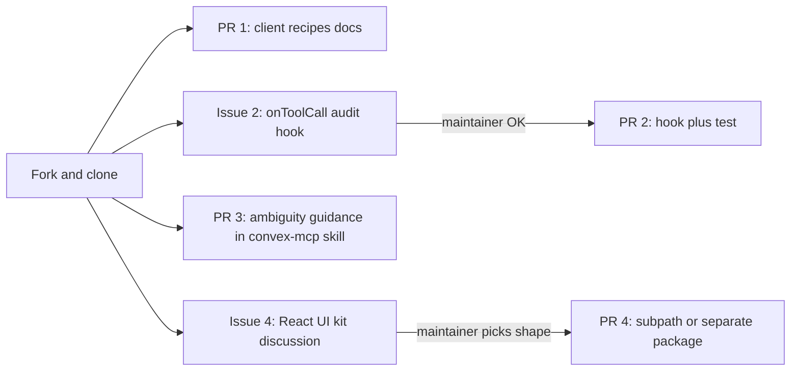

# Contribute better-todo learnings to get-convex/mcp

## Short answer

Use both, in this order: **an issue first for anything that adds API surface, and a direct PR (from a fork) for docs and skill text.**

The repo is about two days old. It has 7 stars, no forks, and the only issues and PRs so far are Renovate's automated dependency updates. It's an official Convex package, so the maintainers decide the API. An unannounced PR that adds a new option or a new package is likely to be redone or closed. A docs PR fixes a clear gap and can go straight in.

`CONTRIBUTING.md` only lists the dev and test commands:

```sh
npm ci && npm run clean && npm run typecheck && npm run lint && npm run test
```

`DESIGN.md` says the component is "pure state + logic" and that tools and routes live in the app. Every proposal below fits that rule.

## What upstream already has (don't duplicate)

- OAuth, API keys, device flow, scopes, `listConnections` and `revokeConnection`
- An example consent page and connections UI in `example/src/App.tsx`
- The `skills/convex-mcp` builder skill and the `skills/convex-mcp-security` audit skill

## Contributions, smallest first



### 1. PR: "Connecting clients" docs (direct PR, lowest risk)

- Add a README section listing a recipe for each client:
  - Claude and claude.ai: paste the URL.
  - Claude Code: keep the existing `claude mcp add` command.
  - Cursor.
  - ChatGPT.
  - **Grok Bot**, which is missing today.
- The Grok Bot recipe takes the lessons from better-todo:
  - A setup prompt that never contains the key.
  - The key is collected through Grok Bot's masked "secure secret request".
  - A warning that Grok Bot's cloud computer is shared by every Bot on the account, so the key must not be saved to files or memory.
  - Cite [docs.x.ai/grok-bot/computer-and-apps](https://docs.x.ai/grok-bot/computer-and-apps).
- Optional: add the same per-client setup prompt to `example/src/App.tsx` next to API key creation, modeled on [src/components/ConnectedAgentsSection.tsx](src/components/ConnectedAgentsSection.tsx).

### 2. Issue, then PR: `onToolCall` audit hook

- **Problem:** every app that wants an activity log has to call a logger inside each tool. better-todo does this in `logActivity` in [convex/mcpTools.ts](convex/mcpTools.ts), and it's easy to forget one.
- **Proposed option on `McpServer`:**

```ts
onToolCall?: (
  ctx: ActionCtx,
  call: { user: McpUser; tool: string; outcome: "ok" | "error" | "forbidden"; durationMs: number },
) => Promise<void>;
```

- **Design notes for the issue:**
  - It runs in the app's httpAction, so it fits DESIGN.md.
  - It passes no args or results by default, so secrets and content don't leak into logs.
  - A failure in the hook is logged and never fails the tool call.
- Open the PR only after a maintainer agrees on the shape. Include a test using `mcpTest.register(t)`, like better-todo's [convex/mcp.test.ts](convex/mcp.test.ts), plus a CHANGELOG entry.

### 3. PR: ambiguity guidance in `skills/convex-mcp` (direct PR, text only)

- Add a reference section on "resolve by phrase, ask instead of guessing":
  - Exact ID first, then exact or unique substring text, then an optional ranker.
  - Return `{ status: "ambiguous", candidates }` instead of acting.
  - Use the same "not found" message for missing and not-yours.
- Base it on `matchInCode` in [convex/lib/typesafe.ts](convex/lib/typesafe.ts) and `resolveByMatch` in [convex/mcp.ts](convex/mcp.ts), but keep it vendor-neutral, with no TypeSafe dependency.

### 4. Issue: React UI kit (discussion only for now)

- Ask the maintainers which shape they want:
  - A subpath export, `@convex-dev/mcp/react`.
  - A separate package.
  - Or a better example only.
- **Proposed headless pieces:**
  - `<ConnectedAgents />`
  - `<McpConsentPage signIn={...} />`, which refuses to render in a frame, handles device codes, shows the redirect host, and labels the client unverified.
  - `buildSetupPrompt(client, { url })`
- **Evidence:** [src/pages/Connect.tsx](src/pages/Connect.tsx) and [src/components/ConnectedAgentsSection.tsx](src/components/ConnectedAgentsSection.tsx) are mostly generic, but their CSS is app-specific. That's why it should be headless or use CSS variables.
- No code until a maintainer replies.

## Mechanics

- `gh repo fork get-convex/mcp --clone`, then one branch per PR (for example `docs/client-recipes`, `feat/on-tool-call`).
- Read the repo's `AGENTS.md` and `.prettierrc.json`, and run the four CONTRIBUTING commands before every push.
- The example app uses Convex Auth. Set `JWT_PRIVATE_KEY`, `JWKS` and `SITE_URL` on your own dev deployment before running `node example/e2e.mjs`.
- Keep each PR to a single concern with a CHANGELOG line. Link each PR to its issue.
- Draft every issue and PR body in `prds/upstream-mcp-contributions.md` first. You review the text, and I file it with `gh` only after you approve each one.

## Not proposing upstream

- **TypeSafe matching:** vendor-specific, so it stays in better-todo.
- **An activity table as a new component:** only revisit this if the maintainers turn down the hook in step 2.
